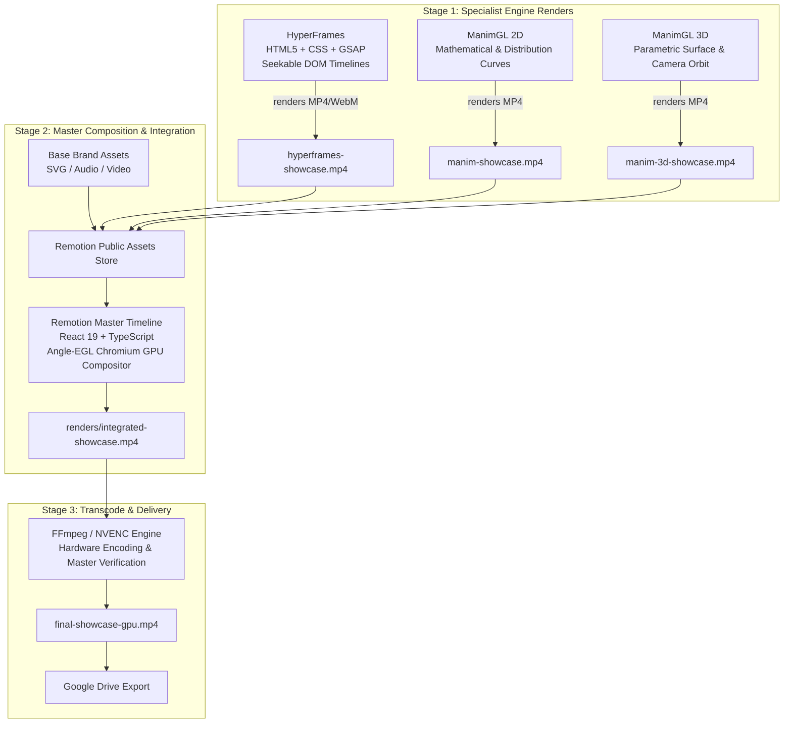

# ALL ENGINES SHOWCASE: Production-Oriented Multi-Engine Video System

An architecture and multi-engine render pipeline combining **Remotion**, **HyperFrames**, **ManimGL**, and **FFmpeg** into a broadcast-grade 1920x1080 @ 30 FPS composition with GPU rendering workflows for local systems and Google Colab.

---

## 1. Supported Rendering Engines & Architecture

Instead of attempting to force disparate rendering paradigms into a single monolithic runtime, this project implements a **staged, media-interchange compositing architecture**. Each engine handles what it excels at natively:



### Engine Responsibilities

1. **Remotion (v4.0.545)**:
   - Primary video compositing and sequencing platform built with React 19 and TypeScript.
   - Manages global frame timing (1800 frames @ 30fps = 60s), audio mixing (`ambient-bed.wav`, synchronized impact hits), layout framing, text overlays, and transitions between native and specialist layers.
2. **HyperFrames**:
   - Modern browser-based motion system utilizing HTML5, CSS Grid, and GSAP 3.
   - Seekable, frame-accurate timeline bound to `window.__timelines["root"]` for telemetry HUDs, live financial meters, responsive bar charts, and kinetic text.
3. **ManimGL (3b1b/manim)**:
   - High-performance mathematical visualization engine with real-time OpenGL rendering.
   - Generates 2D probability distributions (tail risk and compounding growth) and 3D parametric leverage surfaces with ambient camera rotations.
4. **FFmpeg & ffprobe**:
   - Audio/video normalization, stream format validation, color metadata conformity, and optional hardware-accelerated NVENC transcode (`h264_nvenc`).

---

## 2. Directory Structure

```
ALL_ENGINES_SHOWCASE/
├── assets/                          # Base brand graphics, synthetic footage & procedural audio
│   ├── audio/                       # ambient-bed.wav, impact.wav
│   ├── svg/                         # brandmark.svg, grid.svg, orbit.svg
│   └── *.mp4                        # city.mp4, data.mp4, market.mp4, space.mp4
├── colab/
│   └── ALL_ENGINES_GPU_RENDER.ipynb # Google Colab 1-click end-to-end GPU orchestrator
├── docs/
│   ├── ENGINE_RESEARCH.md           # Rationale on engine boundaries & GPU caveats
│   └── PIPELINE_DESIGN.md           # Frame rates, color management & interchange standards
├── hyperframes/
│   ├── index.html                   # GSAP seekable composition (1920x1080 @ 30fps)
│   └── package.json                 # GSAP & HyperFrames dependencies
├── manim/
│   ├── scenes.py                    # RiskAndCompounding & LeverageSurface scenes
│   └── requirements.txt             # Python dependencies (manimgl, numpy)
├── remotion/
│   ├── src/
│   │   ├── Root.tsx                 # Remotion root registering compositions
│   │   ├── index.ts                 # Entrypoint
│   │   └── Showcase.tsx             # SignalShowcase (native) & IntegratedShowcase (master)
│   ├── public/assets/               # Asset folder synchronized before master render
│   ├── package.json                 # Remotion packages & scripts
│   └── README.md
├── scripts/
│   ├── RENDER_ALL.sh                # Complete cross-engine shell pipeline
│   ├── RENDER_HYPERFRAMES.sh        # Isolated HyperFrames renderer
│   ├── RENDER_MANIM.sh              # Isolated ManimGL renderer with Xvfb detection
│   └── RENDER_REMOTION.sh           # Asset sync and Remotion master compiler
├── .gitignore                       # Git ignore filtering renders, node_modules & temp files
├── LICENSES_AND_ASSETS.md           # Attribution & licensing disclosures
├── PREVIEW_HYPERFRAMES.bat          # Local Windows live preview launcher
├── README.md                        # Primary documentation
└── RENDER_ALL.bat                   # Local Windows full render batch script
```

---

## 3. Google Colab GPU Workflow

To render on Google Colab with GPU hardware:

1. Open **Google Colab** and select **Runtime → Change runtime type → T4 GPU** (or A100 / L4).
2. Open [`colab/ALL_ENGINES_GPU_RENDER.ipynb`](file:///C:/Users/say_my_name/Desktop/ALL_ENGINES_SHOWCASE/colab/ALL_ENGINES_GPU_RENDER.ipynb).
3. The notebook supports two ingestion methods:
   - **Direct Git Clone**: Clone this repository directly into `/content/ALL_ENGINES_SHOWCASE`.
   - **ZIP Upload**: If working offline, upload the project archive and it will automatically extract.
4. Run all cells in sequence:
   - **Environment Provisioning**: Installs Node 22, FFmpeg, Mesa, Xvfb, Cairo, Pango, and Python dependencies.
   - **HyperFrames Render**: Executes `npx hyperframes render` with `--gpu` (falls back cleanly if unavailable).
   - **ManimGL Render**: Sets up virtual framebuffer (`Xvfb :99`) and renders both 2D and 3D scenes to `renders/manim/`.
   - **Remotion Master Render**: Automatically syncs outputs into `remotion/public/assets/` and compiles the 60-second integrated master (`--gl=angle-egl` or `--gl=swangle`).
   - **FFmpeg Master Verification & NVENC Transcode**: Validates duration, frame rate, and dimensions, then encodes via `h264_nvenc` if supported.
   - **Drive Export**: Copies final videos to `/content/drive/MyDrive/ALL_ENGINES_SHOWCASE_OUTPUT`.

---

## 4. Local Quick Start

### Prerequisites
- **Node.js**: v22+
- **Python**: 3.10+ with `pip`
- **FFmpeg & ffprobe**: Installed and added to system `PATH`
- **OpenGL Libraries / Virtual Framebuffer**: For ManimGL

### Step-by-Step Local Rendering

#### Linux / macOS:
```bash
# Clone the repository
git clone <repo-url>
cd ALL_ENGINES_SHOWCASE

# Make scripts executable
chmod +x scripts/*.sh

# Run the complete render pipeline
./scripts/RENDER_ALL.sh
```

#### Windows:
```cmd
REM Run the complete render batch script
RENDER_ALL.bat
```

### Running Individual Engines Locally

- **Remotion Live Preview Studio**:
  ```bash
  cd remotion
  npm install
  npm run start
  ```
- **HyperFrames Live Preview**:
  ```bash
  cd hyperframes
  npm install
  npx hyperframes preview
  ```
- **ManimGL Scene Render**:
  ```bash
  cd manim
  pip install -r requirements.txt
  manimgl scenes.py RiskAndCompounding -w -r 1920x1080 --fps 30
  manimgl scenes.py LeverageSurface -w -r 1920x1080 --fps 30
  ```

---

## 5. Showcase Scenes Overview

| Scene Sequence | Timestamp / Duration | Engine | Description |
| :--- | :--- | :--- | :--- |
| **01: Brand Open** | 0s – 5s (150 frames) | Remotion (Native) | Atmospheric typography, animated SVG reticle, ambient audio intro |
| **02: Market Dynamics** | 5s – 11s (180 frames) | Remotion (Native) | Synthetic video background, dynamic HUD telemetry, volatility bars |
| **03: DOM Motion HUD** | 11s – 20s (270 frames) | HyperFrames | GSAP-animated financial ticker, live metric meters, neon telemetry |
| **04: Narrative Interlude**| 20s – 25s (150 frames) | Remotion (Native) | City background with animated progress indicators |
| **05: Non-Linear Geometry**| 25s – 35s (300 frames) | ManimGL 3D | 3D parametric hyperbolic paraboloid surface with ambient camera rotation |
| **06: Probability & Risk** | 35s – 45s (300 frames) | ManimGL 2D | Normal distribution curve highlighting tail risk and exponential compounding |
| **07: Macro Trend Curves** | 45s – 55s (300 frames) | Remotion (Native) | Compound growth curves with interactive SVG elements |
| **08: Outro & Summary** | 55s – 60s (150 frames) | Remotion (Native) | Clean closing sequence linking all three technologies |

---

## 6. GPU Rendering Considerations & Realities

- **Remotion**: Employs Chromium's GPU acceleration via `--gl=angle-egl` on Linux/Colab. If hardware GL flags are unavailable, Remotion automatically cascades to `--gl=swangle` (software rasterization) to guarantee reliable frame generation.
- **HyperFrames**: The `--gpu` flag accelerates the video encoding phase using available hardware video encoders (e.g. NVENC). The headless browser rasterization is governed by Chromium.
- **ManimGL**: Relies on modern OpenGL contexts. In cloud or headless Linux environments like Colab, an X11 virtual display (`Xvfb`) is initialized to allow OpenGL context creation with Mesa driver support.
- **FFmpeg**: Uses NVIDIA NVENC (`h264_nvenc`) when present on the host system for ultra-fast master stream transcode.

---

## 7. Troubleshooting & Known Limitations

1. **Missing Specialist Renders in Remotion**:
   - *Cause*: Attempting to render `IntegratedShowcase` before running HyperFrames or ManimGL.
   - *Fix*: Always run the pipeline in order or use `RENDER_ALL.sh` / `RENDER_ALL.bat`.
2. **ManimGL OpenGL Errors on Headless Linux**:
   - *Cause*: Absence of an active display server.
   - *Fix*: Ensure `Xvfb :99 -screen 0 1920x1080x24 > /dev/null 2>&1 &` is started and `export DISPLAY=:99` is exported.
3. **Chromium Sandboxing in Docker / Root (Colab)**:
   - Handled automatically by Remotion, which passes `--no-sandbox` when running under Linux root environments.
